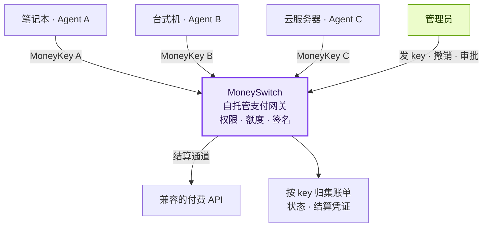
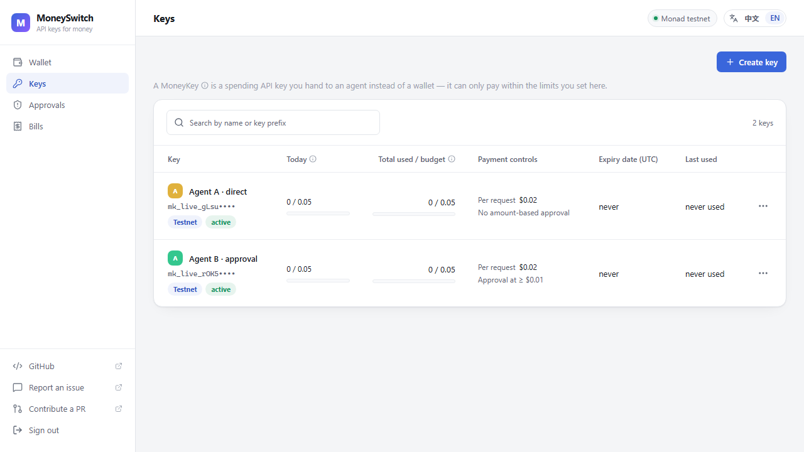
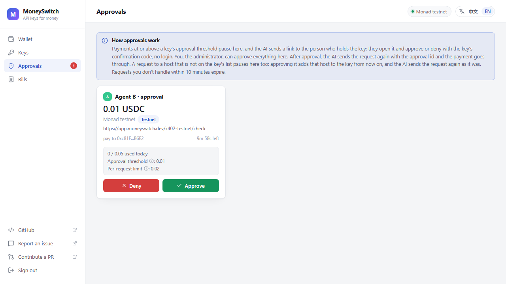
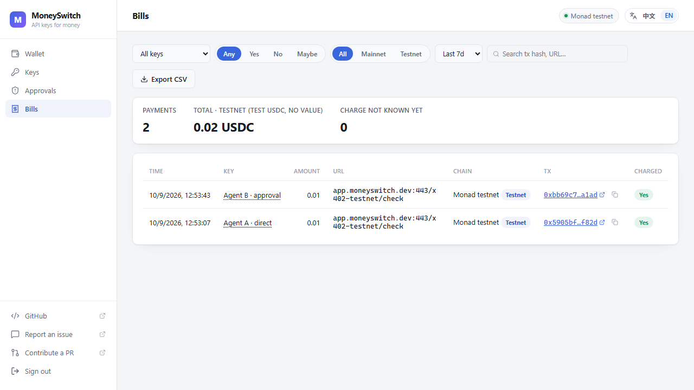

# MoneySwitch

**给 AI Agent 用的可编程支付网关 —— 部署在你自己的服务器上，按 key 管控每一笔支出。**

> 🪞 本仓库为只读镜像。主仓库在 [GitHub](https://github.com/dongsheng123132/moneyswitch)，
> Issue 与 PR 只在 GitHub 接收。

[官网](https://moneyswitch.dev) · [产品演示](https://moneyswitch.dev/videos/technical-demo/) · [开始试用](https://moneyswitch.dev/pilot/zh/) · [English](https://github.com/dongsheng123132/moneyswitch#readme)


你的多个 AI Agent 分布在笔记本、台式机和云服务器上。给每个 Agent 一把有独立支出规则的 **MoneyKey**，统一连接你自托管的支付网关。AI 通过 HTTP API 请求付款，签名密钥始终留在服务端。

- **一个 Agent 一把 key：** 日额度、总额度、单笔上限、允许的域名、有效期，随时可撤销。
- **人掌握支出权限：** 达到或超过设定审批线的付款等待人工批准；硬性额度限制仍然生效。
- **每笔支出可追溯：** 按 key 查看账单、扣款结果和结算凭证链接。

## 这个软件解决什么问题

AI Agent 会调用付费 API、订阅服务、购买数据。把银行卡或长期有效的支付凭证直接交给 Agent 风险很大。MoneySwitch 把「花钱」这件事收口到一个你自己部署的服务：

1. **额度隔离** —— 每个 Agent 只拿到一把受限的支出 key，不是你的主凭证。
2. **人工审批** —— 超过阈值的付款必须有人点「批准」。
3. **完整账单** —— 谁花了多少、花在哪、结果如何，按 key 归集。

## 先看产品怎么用

点击预览图即可在浏览器观看，无需登录。

| 产品实录 · 2 分 02 秒 | 为什么要做支付网关 · 1 分 38 秒 |
| --- | --- |
| [▶ 观看演示](https://moneyswitch.dev/videos/technical-demo/) | [▶ 观看介绍](https://moneyswitch.dev/videos/pitch/) |
| 两把 MoneyKey、直接付款、人工审批后付款、账单记录，以及撤销 key。 | 多设备、多 Agent 的支出难题、产品方案与创作者介绍。 |

## 支付网关怎样连接多个 Agent



部署者控制服务和自己的资金，Agent 拿到的是受限支出 key。支付网关应与 Agent 的操作系统权限隔离，详见[自托管部署指南](deploy/README.zh-CN.md)。

## 真实产品界面

以下是 v0.7.6 实际界面，点击图片可查看原图。

**1. 给不同 Agent 设置各自的额度和审批规则。**

[](docs/media/dashboard-keys.png)

**2. 达到审批线的付款，等待人来批准。**

[](docs/media/dashboard-approval.png)

**3. 看清哪个 Agent 花了多少钱，对应哪笔结算记录。**

[](docs/media/dashboard-bills.png)

## 试用、反馈，也欢迎直接提 PR

| 入口 | 可以做什么 |
| --- | --- |
| [测试环境试用指南](https://moneyswitch.dev/pilot/zh/) | 部署自己的实例、创建测试 key、完成第一笔测试付款。 |
| [提交试用反馈](https://github.com/dongsheng123132/moneyswitch/issues/new?template=early-feedback.yml) | 写下你的使用场景、遇到的问题和改进建议。 |
| [第一次提 PR](https://moneyswitch.dev/contribute/zh/) | 跟着 Fork → 修改 → 验证 → PR 的步骤参与；欢迎文档、接入说明和小范围修复。 |

**一台 MoneySwitch 只替一个出钱的人花钱。** 你自己在自己的机器上用、公司给员工的 AI 发 key、公司给自己的 bot 用，都是一个出钱的人：账上的钱全是部署者自己的。key 由管理员发，没有注册，没有用户账号。

## 从代码运行

需要 Node.js 22+ 和 pnpm。

```sh
pnpm install --frozen-lockfile
pnpm build
node apps/server-pkg/dist/cli.js --data-dir ./data
```

首次启动会打印管理员令牌和一条一次性登录链接（30 分钟内有效，只能用一次）。打开链接即可登录。请把 `MONEYSWITCH_PUBLIC_URL` 设成大家访问这台服务的地址，审批链接和技能说明都用它（默认 `http://127.0.0.1:4020`）。

后台只有 4 个页面加登录：

| 页面 | 做什么 |
|---|---|
| **钱包** | 创建结算账户，助记词只显示一次，抄下后勾选「我已抄下」。重启后自动解锁。 |
| **Key** | 一个 AI 一把。选环境类型（测试 / 正式），填日额度、总额度、单笔上限、允许的域名、审批线、过期时间。创建后 key 和技能段落只显示一次。每把 key 还有一个**确认码**（4–6 位数字）给用这把 key 的人，不给 AI。发出后额度和类型不可改：要改就撤销旧 key、发一把新的。 |
| **审批** | 批准或拒绝超过审批线的付款，或请求了不在允许列表里的域名。持 key 的人不用登录：审批链接直接打开，输入确认码即可处理。 |
| **账单** | 每一笔：时间、key、金额、网址、结算通道、凭证号、扣款状态。可筛选、可导出 CSV。 |

AI 用 `POST /v1/fetch` 付款。超过审批线时返回 `approval_required`，带 `approval_id` 和 `approve_url`。技能让 AI 把链接发给持 key 的人，并轮询审批结果。链接本身不含令牌，也不用登录：打开就看到这一条，输入确认码即可批准或拒绝。

## 自己的服务器

[部署说明](deploy/README.zh-CN.md)：Docker Compose、HTTPS/Caddy、持久数据卷、健康检查、备份和回滚。**不要把服务和 AI 放在同一台机器、同一个系统用户下**：AI 能直接改数据库、绕过额度。同一个 SQLite 数据卷只运行一个写入实例。

## 技术细节

MoneySwitch 通过可插拔的结算通道完成付款，当前支持基于 [EIP-3009](https://eips.ethereum.org/EIPS/eip-3009) 授权转账的链上稳定币结算，以及测试环境。

| 网络 | CAIP-2 | 说明 |
|---|---|---|
| 测试环境 A | eip155:10143 | 测试用，无货币价值 |
| 测试环境 B | eip155:84532 | 测试用，无货币价值 |
| 正式环境 A | eip155:143 | 需真实资金 |
| 正式环境 B | eip155:8453 | 需真实资金 |

默认只开测试环境。每把 key 要么是测试 key、要么是正式 key，发 key 时选定，之后不能改。每笔 `/v1/fetch` 的返回都带 `charged: yes | no | maybe`。已签名但结果不明的付款是 `payment_unknown`，**AI 不得自动重试**；服务稍后对账并补上凭证号。

[SPEC.md](SPEC.md) 是唯一有效的规格。

## 不做什么

永远不做：法币出入金、换币、跨链桥、发币、收款 / 卖方功能、替别人保管钱——包括开放注册、每个用户一份余额、充值 / 提现、兑换码、加价转售。MoneySwitch 是自托管软件，只花部署者自己的钱。增加注册、余额、充值或支付集成的 PR 会被关闭。详见 [SPEC.md](SPEC.md) §8。

## 验证与许可

```sh
pnpm test
pnpm test:e2e
node scripts/deploy-smoke.mjs
```

服务端、核心和 Dashboard：AGPL-3.0-only；`apps/demo-seller` 和 `apps/qwen-agent`：Apache-2.0。详见各包 LICENSE。

---

> 🪞 再次提醒：本镜像仅作分发用途。请到
> [github.com/dongsheng123132/moneyswitch](https://github.com/dongsheng123132/moneyswitch)
> 提交 Issue、PR 与反馈。
